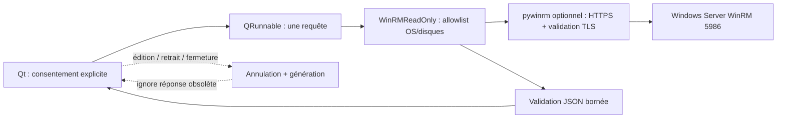

# OpenRemote Studio V31.8 — R94 : inventaire Windows WinRM dans Qt et correction des délais

**Auteur : Abdelhalim Talbi.** 24 octobre 2026. Statut : code sur branche draft, **non qualifié WinRM réel**.

## Besoin et correctif P0

L'adaptateur R93 envoyait `operation_timeout_sec=min(20, timeout-10)` et `read_timeout_sec=timeout`. La bibliothèque pywinrm exige que le second soit **strictement supérieur** au premier plus dix secondes. Aux bornes usuelles (15 et 30 s), l'égalité provoquait une erreur avant l'exécution de la requête.

R94 utilise `operation_timeout_sec=min(20, timeout-11)`. Un test contractuel injecte une fausse bibliothèque winrm et vérifie les bornes 15, 16, 29, 30, 31 et 60 secondes, le certificat validé et le transport NTLM. Ce test est un contrat de paramètres, pas une connexion Windows Server.

## Interface Qt

**Outils → Inventaire Windows WinRM (lecture seule)** ouvre `Application/winrm_inventory_qt.py`. Le panneau est hors ligne par défaut et ne lance aucun polling. L'opérateur renseigne une origine HTTPS et un compte, puis coche le consentement et clique sur « Lire l’inventaire ».

Une demande de mot de passe masquée et éphémère est utilisée si aucun fournisseur de secret n'est injecté. Un `credential_provider` peut être fourni par un futur coffre **par référence** ; R94 ne prétend pas avoir relié ce coffre. Aucun mot de passe n'est écrit dans un profil, exporté, affiché ou journalisé. Python ne garantit toutefois pas l'effacement mémoire cryptographique d'une chaîne après usage.

Le worker `QRunnable` exécute uniquement `WinRMReadOnly.inventory(online=True)`, qui conserve la requête PowerShell constante Get-CimInstance (OS et disques), HTTPS vérifié et la validation JSON bornée. Les exceptions de transport sont remplacées par des codes fixes. Le panneau ne montre que les champs normalisés. Aucune commande PowerShell libre, aucun service démarré/arrêté, aucun changement distant.

## Annulation, concurrence et absence de fuite

Toute modification d'origine/compte, retrait du consentement, masquage ou fermeture invalide la génération courante et annule coopérativement la requête. Une réponse ancienne ne peut plus modifier l'interface. **Un nouveau POST est interdit tant que l'ancien n'a pas terminé**, car l'annulation ne peut pas interrompre un POST WinRM déjà en cours. Les timeouts de transport restent la borne d'attente.

### Architecture

## Tests prévus et limites de preuve

- `Application/tests/test_winrm_timeout_r94.py` : 2 tests (paramètres pywinrm et mode hors ligne).
- `Application/tests/test_winrm_inventory_qt_r94.py` : 5 tests Qt (hors ligne, origine invalide, affichage, annulation sans chevauchement, expurgation d'exception).
- CI Windows native : test de contrat avant build, tests Qt offscreen après installation des dépendances.
- CI cumulative : compilation des sources et contrat WinRM, puis packaging Windows.
- CI OpenSSH : régressions SSH existantes et tests R94 synthétiques, **aucune recette WinRM réelle**.

**À vérifier sur le SHA exact après exécution** : résultats CI, installation/désinstallation Windows, artefacts cumulés, manifestes et SHA-256. Aucun test Windows Server, certificat CA réel, permissions CIM réelles, rotation Vault, ni recette opérateur Windows physique n'est encore attesté. La dépendance `pywinrm` reste optionnelle et peut être absente du binaire : le panneau doit alors signaler `winrm_dependency_missing`.

## G0 — 12 références après R94

MobaXterm PARTIAL ; Royal TS PARTIAL ; Devolutions RDM PARTIAL ; mRemoteNG PARTIAL ; Termius PARTIAL ; Windows Admin Center **PARTIAL** (backend et panneau Qt, réseau réel UNVERIFIED) ; Ansible NOT_IMPLEMENTED ; Zabbix NOT_IMPLEMENTED ; Grafana NOT_IMPLEMENTED ; NetBox PARTIAL ; Wireshark NOT_IMPLEMENTED ; HashiCorp Vault NOT_IMPLEMENTED. **7 PARTIAL, 5 NOT_IMPLEMENTED, 0 IMPLEMENTED.**

## Suite prioritaire

Qualifier WinRM HTTPS avec CA et compte limité sur serveur Windows jetable ; relier un coffre par référence avec TTL et révocation, puis automatiser la recette Qt sur poste Windows réel. Préserver `main`, ne jamais activer de commande arbitraire ou de déploiement.
